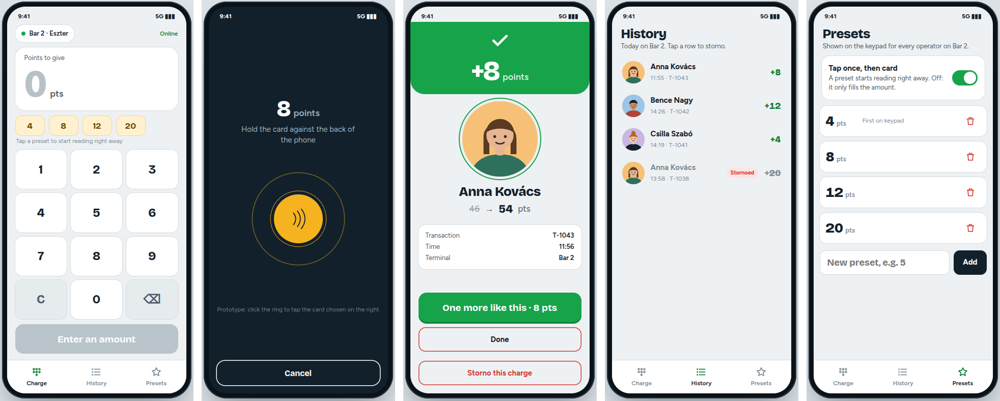
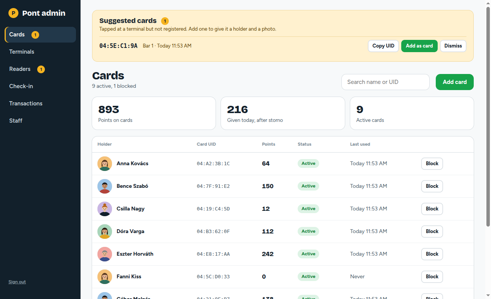
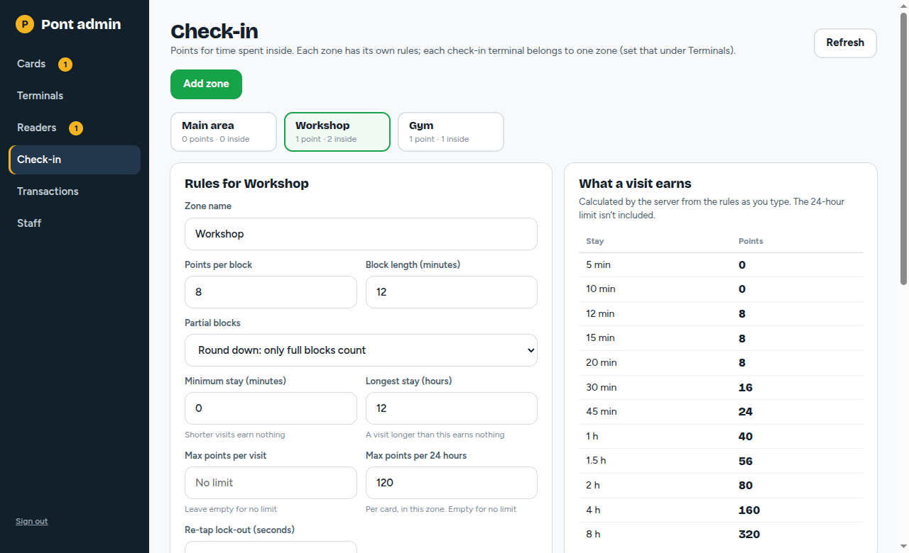
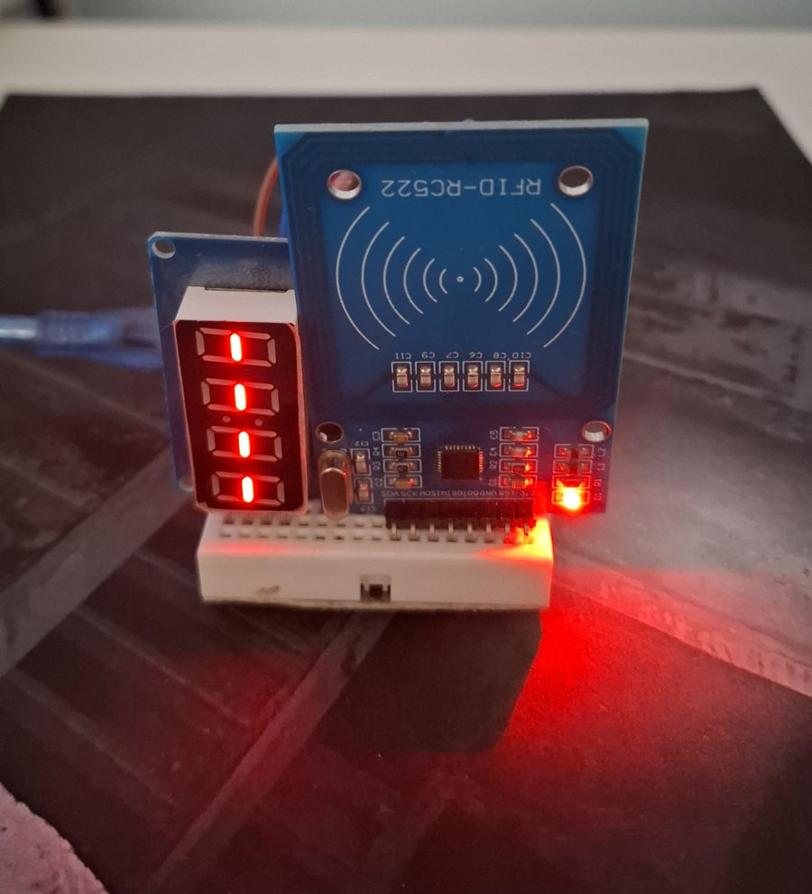
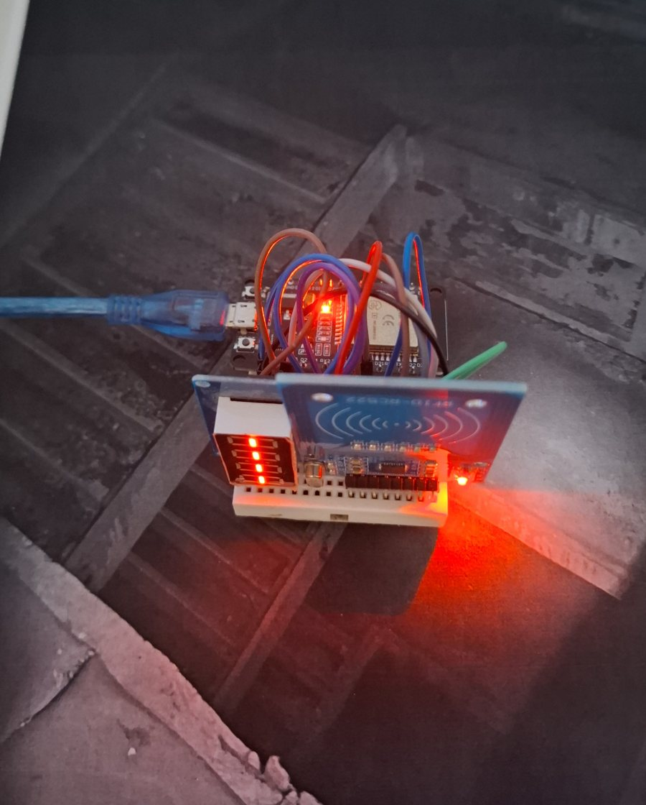
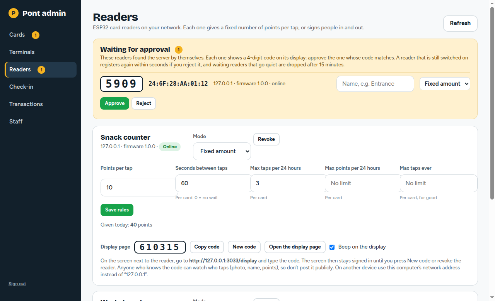
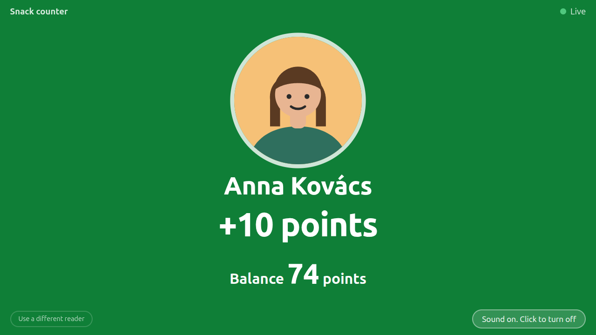
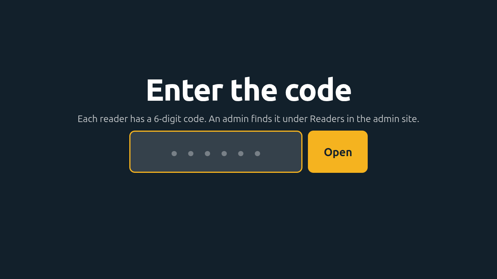
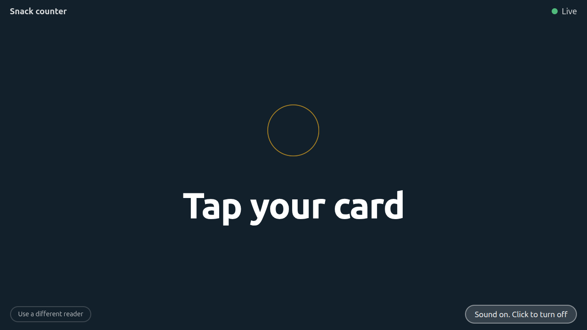
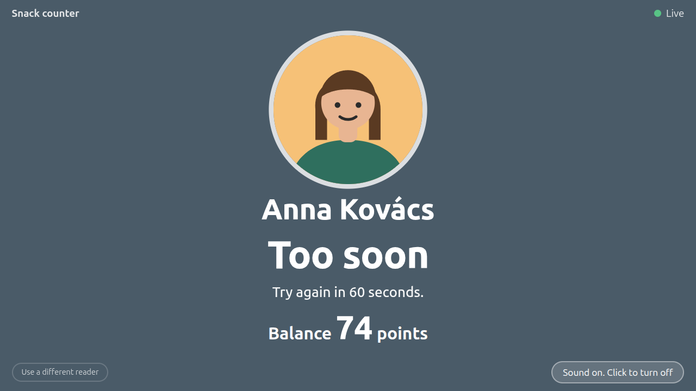

# Pont ATM

A points system for events, clubs and workspaces. People carry an NFC card (MIFARE Classic 1K works, since only its UID is read), and points go onto the card's balance on the server. There are three ways to give points, and they can run side by side:

- **Phone as a point ATM.** An operator types an amount (or taps a preset), taps a card on an Android phone, and the points are credited. The phone shows a progress bar, beeps, and shows the cardholder's photo so the operator can check the face. Operators can storno (refund) a charge without the card.
- **ESP32 readers.** A small box (ESP32 + MFRC522 + 4-digit display) that gives a **fixed number of points per tap** or works as a **sign-in / sign-out point**. See [ESP32 readers](#esp32-readers).
- **Check-in zones.** Points for time spent inside: sign in at a door, sign out when leaving, and the server pays by the zone's rules.

An **admin website** manages cards (with photos), terminals, readers, zones, staff and every transaction. A **display page** can show each tap live on a screen next to a reader.



*The terminal app. These images come from the clickable design prototype in `sketch/` (made with made-up people), not from a phone, and the app has no sign-in screen: a phone is paired with a code.*



*The admin site with dummy data. More screenshots: [Transactions](docs/images/admin-transactions.png), [Terminals](docs/images/admin-terminals.png), [Check-in zones](docs/images/admin-checkin.png), [Readers](docs/images/admin-readers.png).*

```
sketch/     Clickable HTML prototype (the approved design reference)
server/     Node + SQLite server and the admin website (served at /admin/)
android/    The terminal app (Kotlin, Jetpack Compose)
firmware/   ESP32 reader firmware (PlatformIO) with wiring and photos
docs/       Design spec, implementation plan, device test checklist, images
run-server.sh   Starts the server in the foreground using ~/.config/pont-atm/env
```

## Run the server

Needs Node 22.

```bash
cd server
npm install
JWT_SECRET=change-me ADMIN_EMAIL=admin@pont.example ADMIN_PASSWORD='choose-a-password' npm run dev
```

- `./run-server.sh` (in the repo root) does the same for a built server: it reads `~/.config/pont-atm/env`, builds when the source is newer than `dist/`, and runs the server in the foreground. It refuses to start while the `pont-atm` systemd service is running (both would want the same port).
- The admin site is at `http://localhost:3000/admin/`. The admin account is created on first start from `ADMIN_EMAIL` and `ADMIN_PASSWORD`.
- `PORT` (default 3000), `DB_PATH` (default `./data/pont.db`; photos are stored next to it) and `JWT_SECRET` (required; use a long random value) are the settings. Set `TRUST_PROXY=1` when the server sits behind a reverse proxy, so attempt limits count each client separately.
- Tests: `npm test`.
- Put it behind HTTPS before real use. The release app refuses plain HTTP.

## Run it as a service on Tailscale

This is how it runs on the dev machine. The server listens only on the machine's Tailscale address, so only devices on your tailnet can reach it (Tailscale encrypts the traffic).

```bash
cd server && npm install && npm run build          # build once; `npm start` runs dist/index.js
mkdir -p ~/.config/pont-atm ~/.local/share/pont-atm
# ~/.config/pont-atm/env (chmod 600): JWT_SECRET, ADMIN_EMAIL, ADMIN_PASSWORD, PORT=3000,
#   HOST=<this machine's Tailscale IP, from `tailscale ip -4`>, DB_PATH=$HOME/.local/share/pont-atm/pont.db
```

A systemd user unit (`~/.config/systemd/user/pont-atm.service`) runs `node dist/index.js` from `server/` with that env file; `systemctl --user enable --now pont-atm` starts it, and `loginctl enable-linger $USER` keeps it running after logout and across reboots. Logs: `journalctl --user -u pont-atm`. After pulling new code, run `npm run build` and `systemctl --user restart pont-atm`.

Address for the app and admin site: `http://<machine>.<tailnet>.ts.net:3000` (the debug APK allows plain HTTP). For HTTPS, which the release app requires, enable Tailscale Serve for the tailnet, set `HOST=127.0.0.1` and `TRUST_PROXY=1`, then run `tailscale serve --bg --https=443 http://127.0.0.1:3000`. Do not set `TRUST_PROXY=1` without a proxy in front: clients could then fake their address and dodge the login limit.

## Set up a terminal

1. In the admin site: **Terminals**, **Pair a phone**: name it (like "Bar 2") and note the 6-digit code (valid 10 minutes).
2. **Cards**, **Add card**: holder name, photo, card UID, starting points. To register a card without typing its UID: tap it on a terminal, and on the "Card not registered" screen press **Suggest for addition**. It then shows up on the admin site's Cards page under **Suggested cards**, with **Copy UID** and **Add as card** (the form opens with the UID already filled in).
3. On the phone: enter the pairing code. That is all: there is no sign-in, and the phone goes straight to the keypad. Charges are recorded under the terminal's name. To retire or lose a phone, revoke its terminal in the admin site, or use **Unpair** in the phone's terminal menu. The server address is fixed in the app at build time: put `pont.baseUrl=http://your-server:3000` in `android/local.properties` (git-ignored) or build with `-Ppont.baseUrl=...`, and rebuild to point at another server. Without a setting the app points at `http://10.0.2.2:3000`, which is your computer as seen from the Android emulator.

**Home page and apps:** the server's home page (`/`) links to the app page, the program and the display; it does not list the admin site or the staff apps (the admin site is at `/admin/`). The app page (`/app`) offers **Pont Card**, big and first, and at the very bottom small download buttons for the two staff apps (just their names). **Pont Card** anyone can install to see their own card's photo, points and history (hold the card to the phone to add it; read-only, no account; a phone keeps one card, its owner's, and to use a different one you remove the first). **Pont Terminal** is the card terminal for staff phones, and **Pont Admin** is the admin site in an app, with a layout made for phones and a card scanner. In Pont Admin a scan button sits in the Cards search box (it fills in the card's UID, so the list shows that card, ready to open and adjust) and next to the UID field of the card window (to add a card or give someone a new one), and a notice says when the card already belongs to someone. The scanner is switched on only while the sheet “Hold a card to the phone” is open. In the app you stay signed in for a week (the app asks for a long token, which only an admin can get; a browser keeps the usual 12 hours and signs out when the tab closes). Changing an admin's password, role or switching the account off ends every sign-in at once, and Sign out forgets it on that phone. Admins can also sign in by holding a key (a card or tag) to the phone: on the Staff page, “Set key” stores its UID for an admin (type it, or press the scan button), and the app's sign-in screen has “Sign in with a key”. A key can't also be a points card, two admins can't share one, changing or removing it signs out everyone who used it, and wrong keys are rate limited like wrong passwords. A card's number can be copied, so a key is as safe as the card is private. Excel exports are saved into the phone's Downloads folder. The same admin site works in any phone browser, just without the scan buttons. Publish new builds with `deploy/publish-apps.sh`. The card app asks the server for a card by its number, so lookups are rate limited per address (a number is only as secret as the card is, like at every reader).

**Info kiosk mode:** a reader or a terminal phone can be set to *Info kiosk* (Terminals or Readers tab, or when approving or pairing). Tapping a card then changes nothing: a phone shows the photo, points and recent history, a reader shows the points on its digit display, and a display page next to it shows everything the app would.

**The event program:** the server holds one program (`GET /public/program`, no sign-in; an admin replaces it with `PUT /program`, which checks every event and keeps the old program if anything is wrong). It lists the days, the points goal (for example 60 in all and 30 on one day) and the events, each with its hours, room and how it scores: `rate` (points per block of minutes, with an optional cap and longest stay), `tasks` (a list of items, each with points and minutes) or `flat` (an award for staying to the end). A new server starts with a small example program (`server/src/program-default.ts`); the real one is typed in or imported as JSON on the admin page. That is the admin site's **Program** page (after Check-in): edit the title, goal and days, add, edit and delete events (a window whose fields follow the scoring model; the id of an event is made from its title and never changes), **Import JSON** (paste a whole program; the server's message is shown if it is refused and the program is kept), **Export JSON** (copy or download) and **Clear all events**. Every save takes the program as the server has it, changes it and sends the whole thing back. The website shows it at `/program` as lanes (one row per event, time across, fixed hours as solid bars and open-for-hours events as dashed bands, a live “now” line, hearts, and a details panel); it never asks a visitor for a card number. Pont Card has the **Program** tab (Plan and Pulse): on Plan you drag an event card onto the line of your day, drag the edges to choose how long you stay, and the points follow (✕ Skip or a swipe to the left sets an event aside, “Bring back” returns them); Pulse follows the real clock every minute and shows what is open then. The points on top are planned ones on Plan and the card's real ones on Pulse. Likes, skips and plans stay on the phone, and the program is kept for offline use. The minutes per task are estimates, so points for a short stay at a task event are approximate.

**Importing many cards:** on the Cards tab, **Import cards** takes a pasted list and the pictures. Paste rows (a first row naming the columns, like `name, uid, points, photo`; `points` and `photo` are optional; commas, semicolons or tabs, so a copy from Excel or Sheets works), then choose the pictures (or a whole folder). Each row's `photo` is the picture's file name, matched ignoring capitals and folders (`anna` also finds `anna.jpg` when only one file has that name). The list is checked as you paste: a bad or repeated card UID, a UID already on a card, a missing name or bad points are shown on their row, and nothing is imported until every row is fine (up to 1000 cards at a time). Pictures are cut to a centred square, made 400 px and saved as JPEG in your browser before they are sent, so a multi-megabyte phone photo becomes about 30 KB and readers load it at once; the same goes for a photo added to a single card. A photo that cannot be added (or a name that matches no picture) never blocks the cards: they are made, and the window says which photos to try again.

**Live admin pages:** the admin site updates by itself over a WebSocket (`/ws`): a card tapped, a reader appearing, a phone coming online, a check-in or an edit by another admin shows up within a moment, with a small Live indicator in the side bar. A page never refreshes under you while a form or drawer is open or a field has unsaved text; it waits and then updates. Behind a reverse proxy, `/ws` must be passed with the WebSocket upgrade headers (see `deploy/nginx-pont.example.com.conf`).

**Many phones at once:** on the Terminals tab, **Pair many phones** takes one phone per line, the place first and then the terminal name (`Floorball Terminal 1`; the first word is the place, or write `Main hall | Bar 2` for a place of several words). Choose ATM or check-in mode (with its zone and point type) and how long the codes work (10 minutes up to 7 days), and you get a table of pairing codes you can copy or download as an Excel file. The codes are shown only once. Each works once, and anyone holding one can pair a phone as that terminal, so keep the table private and use the shortest time that suits you.

## Build the app

Needs JDK 17 or newer (the Android Gradle Plugin does not run on Java 11) and the Android SDK.

```bash
cd android
export JAVA_HOME=/usr/lib/jvm/java-21-openjdk-amd64   # any JDK 17+
export ANDROID_HOME=$HOME/Android/Sdk
./gradlew :app:assembleDebug        # app/build/outputs/apk/debug/app-debug.apk
./gradlew :app:testDebugUnitTest    # JVM unit tests
```

Both builds use the server address set at build time (see above). Plain HTTP is allowed only to `*.ts.net` (Tailscale encrypts it) in release, and to anything in debug. The debug build also shows two small "debug tap" links on the waiting-for-card screen so you can test without a card.

## How cards are identified

The app reads the card's UID (4, 7 or 10 bytes) and sends it to the server, which owns every balance. Nothing is stored on the card, so nobody can edit a card to gain points. A UID can be cloned with cheap hardware, which is acceptable for low-value points. If that matters, the next step is a secret block on the card checked by the server.

**Phone caveat:** only phones with an NXP NFC chip can read MIFARE Classic *sectors*. Reading the UID works on every NFC phone, which is all v1 needs. Test the terminal phones with your real cards before buying a batch (see `docs/device-test-checklist.md`).

## Check-in mode (points for time inside)



A terminal can be a sign-in / sign-out point instead of an ATM. In the admin site:

1. **Check-in** page: make **zones** (like "Workshop", "Gym"). Each zone has its own rules: points per block (say 8 per 12 minutes), how a partial block is rounded (down, up, nearest, or exact per minute), minimum stay, max points per visit, max points per 24 hours (per card, per zone), the longest stay that counts, and a re-tap lock-out. **Export JSON** and **Import JSON** on this page copy all zones as `{ "zones": [ { "name", "settings" } ] }` and bring them back (`POST /zones/import`, admin only, up to 100 zones): a name that already exists (any letter case) gets the new rules, any other name makes a zone, nothing is deleted, and if any zone is wrong the server names it and changes nothing. A live table shows what a stay of 5, 12, 30, 60… minutes earns.
2. **Terminals** page: set the terminal's mode to **Check-in**, pick its **zone**, and its **point type**: *Toggle* (in if outside, out if inside), *Sign in only* or *Sign out only*. The phone follows within about 30 seconds.

While waiting the phone has no buttons: "Tap your card" (or "Tap to sign in" / "Tap to sign out") and the zone name. After a tap it shows the photo, name, time and points, with a **Cancel this check-in / check-out** button, then goes back to waiting after a few seconds. A tap on the next card replaces the screen at once. Unpair and the beep switch are behind a **long press on the terminal name** at the bottom.

Good to know: a visit is paid by the rules of the zone where it began, whichever point signs out. A visit longer than the zone's longest stay earns nothing (forgotten sign-outs can't farm points). **Nobody is in two places at once:** tapping a sign-in or toggle point of *another* zone while still inside one cancels the old visit (no points for it) and signs the card in at the new zone, and every screen warns about it (the phone and the display page say the old visit was cancelled, a reader's digits flash `dISC` before `In`). A sign-in point of the *same* zone just says the card is already inside, and a sign-out point does nothing for someone who isn't inside. Admins see who is inside, with Sign out and Discard buttons, and can storno a check-out award in Transactions. Admin grants and deductions (Cards, then a card, then Grant or take away) are listed in Transactions with who did it and why.

**Undo, and closing up after an event.** Every result can be undone: the phone offers *Cancel this check-in / check-out* (and *Storno this charge* for a grant), the admin has *Cancel check-out* in the Check-in page's recent visits and *Cancel check-in*, *Cancel check-out* and *Storno* in a card's report, and a reader's display page can show a *Cancel this* button (switched on per reader under Readers, **off by default** because anyone at that screen could then undo the last tap). Cancelling a check-out takes its points back and reopens the same visit; it is refused if the card has since checked in somewhere else or no longer has the points. The same goes for a refund: it needs the card to still have the points. At the end of an event, each zone on the Check-in page has **Sign out everyone** (paid by the zone's rules; visits longer than the longest stay earn nothing) and **Discard everyone** (no points), both with a confirmation that says how many people and how many points.

**Report for one person.** Cards, then **Report** (or click a holder's name anywhere in the admin): totals (points now, time inside, visits, points from check-outs, from grants, refunds, adjustments, and what the card started with, which add up to its balance), a **horizontal timeline** (a lane per zone with each visit as a bar, green paid, red cancelled, amber not signed out, blue inside now; and a lane of grants, refunds and adjustments; only days with activity are drawn, with zoom), the totals per zone, and the full log of everything: when, what, which terminal and zone, how long, how many points, who. The log can be downloaded as Excel, and its rows have the undo buttons above. It updates live.

## ESP32 readers



A reader is a self-contained box built from three cheap parts: an **ESP32 DevKit V1**, an **MFRC522** card reader (13.56 MHz) and a **TM1637 4-digit 7-segment display**, wired as in [`firmware/esp32-reader/README.md`](firmware/esp32-reader/README.md) (which has the full wiring table, flashing steps and troubleshooting). The photo shows the display in the middle of its loading bar: one line per digit, one step per stage of a tap.



**How a reader joins**

1. Flash the firmware with your WiFi name, password and the server address (kept in `include/config.h`, which git ignores).
2. The reader registers with the server by itself and shows a **4-digit pairing code** on its display. If it cannot reach the server it shows `nEt`, never the code.
3. In the admin site, **Readers** lists the waiting reader with the same code and its IP address. You match the code on the display, name the reader, choose its mode, and press **Approve**. A code that doesn't match is a different device: don't approve it.
4. Within a few seconds the display shows `----` and the reader works. It keeps its identity across restarts and power cuts.

**Two modes** (switchable any time in admin, no reflashing):

- **Fixed amount**: every tap gives X points. Limits are per card: points per tap, seconds between taps, max taps and max points per rolling 24 hours, max taps ever. When a limit stops someone, the display shows the reason (`PAUS` or `FULL`) and then their balance. Grants appear in Transactions and can be stornoed like any other.
- **Check-in**: the reader is a sign-in, sign-out or toggle point for a **zone** and pays by that zone's rules (see below). Signing in shows only `In`; signing out shows `OUt` and then the points balance.

**What you see on the display.** `----` when ready; while a tap is processed, a loading bar of four lines (a line in the middle of digit 1, then 2, 3, 4), then the balance. Words: `In`, `OUt`, `PAUS` (too soon), `FULL` (limit reached), `nOIn` (not signed in), `bLoc` (card blocked), a blinking `----` (card not registered), `nEt` (no network), `OFF` (revoked). The display never blocks: tap the next card while a result is still showing and it replaces the display at once. The full list is in the firmware README.

**Details worth knowing**

- **Fast.** The reader sends the tap straight away over HTTP on your LAN. The bar steps are tied to real stages (card read, request sent, answer arriving, answer understood), so the bar is only as slow as the server.
- **Safe to retry.** Every tap carries a one-time key. If the answer is lost and the card is tapped again, the server returns the first result instead of giving the points twice.
- **Identity.** The reader makes a random secret on first start and keeps it in its flash memory. The server stores only a hash of it, so a device that copies the reader's id cannot take its place. After approval the server hands the reader a terminal token (once), which it keeps and uses like a phone does. Revoking the reader in admin cuts it off at once.
- **Limits of the hardware.** 2.4 GHz WiFi only. Plain HTTP, so use it on a network you trust (a LAN or Tailscale). It reads only the card's UID, never the card's secret sectors. A UID can be cloned with cheap hardware, which is fine for low-value points.
- **No hardware yet?** `node firmware/esp32-reader/tools/fake-reader.mjs http://<server>:3000` pretends to be a reader in the terminal. The display logic is also tested on a computer (`firmware/esp32-reader/test/host/run.sh`, 255 checks).



## Display pages (a screen next to a reader)

Every terminal has a **display page**: a screen next to the reader that shows each tap live, with the photo, name, a headline ("+10 points", "Checked in", "Too soon", "Card is blocked"), details and the balance. It returns to "Tap your card" after 6 seconds, and a new tap replaces it at once.



| Enter the code | Waiting | A refusal |
|---|---|---|
|  |  |  |

**To use it:** on the screen, open `/display` on the server (like `http://192.168.x.x:3000/display`; on another device use this computer's network address, not `localhost`) and type the reader's **6-digit code**. The code is on the admin **Readers** tab under each reader (and next to each phone on the Terminals tab). The screen then stays signed in, even after a restart, until you press **New code** or revoke the reader. The code never appears in the address. The page's "Use a different reader" button signs a screen out.

- In admin, **Copy code** copies it, **New code** replaces it and signs out every screen that used the old one at once, and **Beep on the display** switches the beep on or off. Browsers only allow sound after a click: the page shows "Click here once to allow sound", and its button then toggles sound on that screen.
- Wrong codes are limited (10 per address per 15 minutes, 300 per hour overall), because 6 digits can be guessed.
- Anyone who knows a code can watch who taps (photo, name, points), so don't post it publicly. A screen can only show photos of cards that tapped on its reader in the last hour.
- `?hold=15` on the address keeps each result on screen for 15 seconds (1 to 60) instead of 6.

## Behavior worth knowing

- A charge carries a one-time key. If the connection drops and the operator taps again, the server returns the original result instead of crediting twice.
- Storno reverses one charge in full and is refused if the card has already spent those points.
- Blocked cards and unregistered tags are refused with a clear message and change nothing.
- No offline mode. If the connection drops during a charge, the phone says it couldn't confirm: the card may already have been credited, so the operator taps again (the server answers once) or checks History before charging again.
- A paired phone stays paired until it is revoked in admin or unpaired on the phone. Anyone holding an unlocked paired phone can charge points, so revoke a lost phone straight away. Admin sessions last 12 hours and end at once when a password is reset or an account is switched off. Admin login and pairing lock out for 15 minutes after 10 wrong attempts.

## Security note

The server speaks plain HTTP unless you put HTTPS in front of it. The ESP32 readers (and the debug app) send card UIDs, tokens and the admin login unencrypted, so run it only on a network you trust (a home or office LAN, or Tailscale) or behind an HTTPS reverse proxy. Card UIDs can be cloned with cheap hardware, which is fine for low-value points but not for money. Use a long random `JWT_SECRET` (the server refuses to start with fewer than 32 characters; make one with `openssl rand -hex 32`), a strong admin password, and revoke lost phones and readers straight away.

## License

[MIT](LICENSE)
