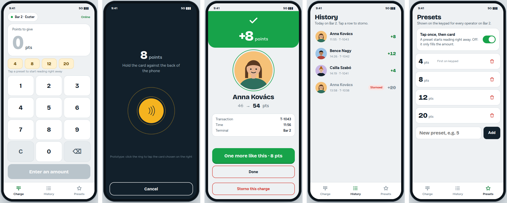
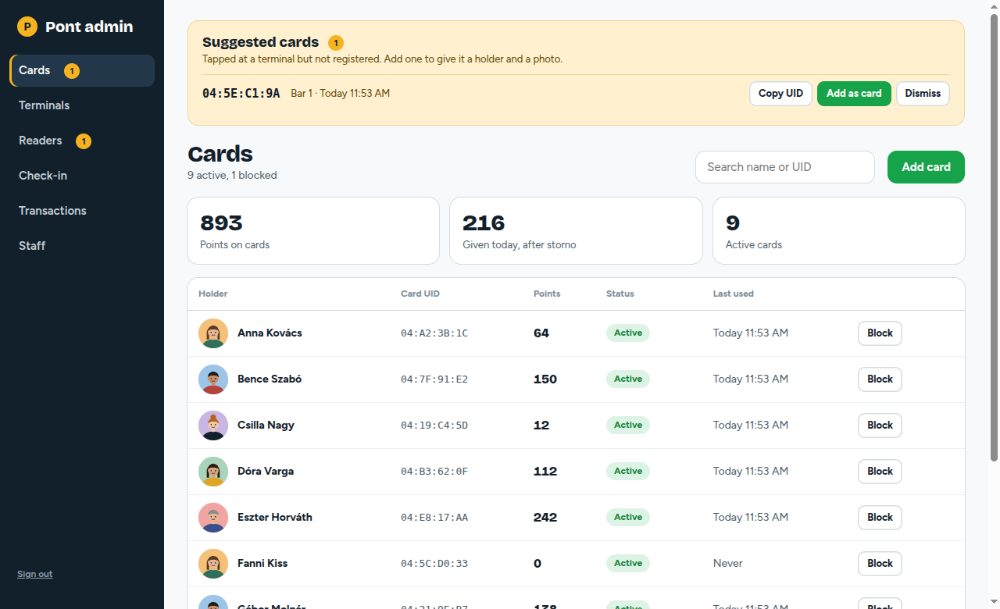
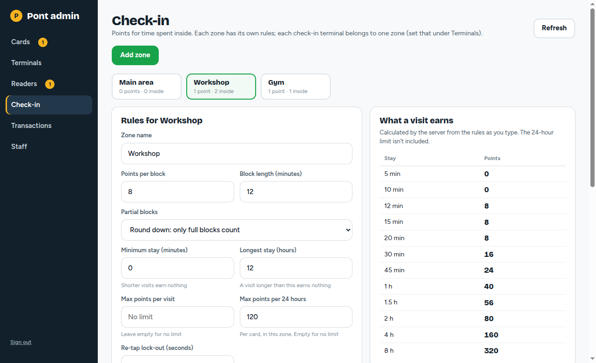
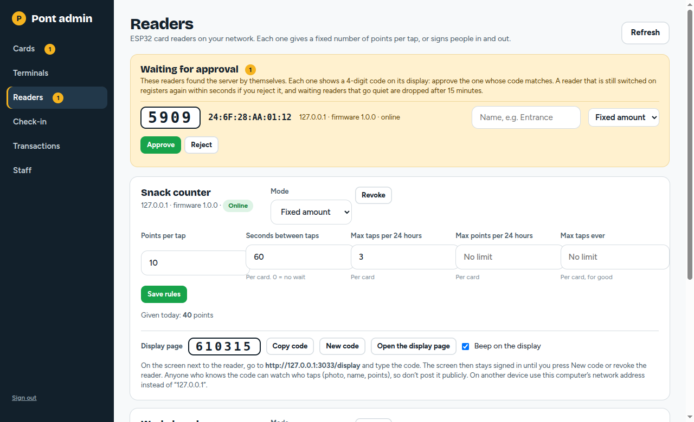
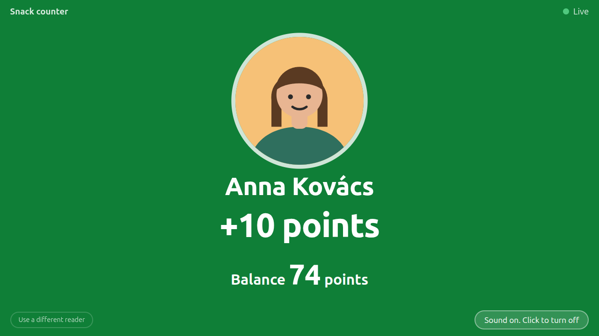
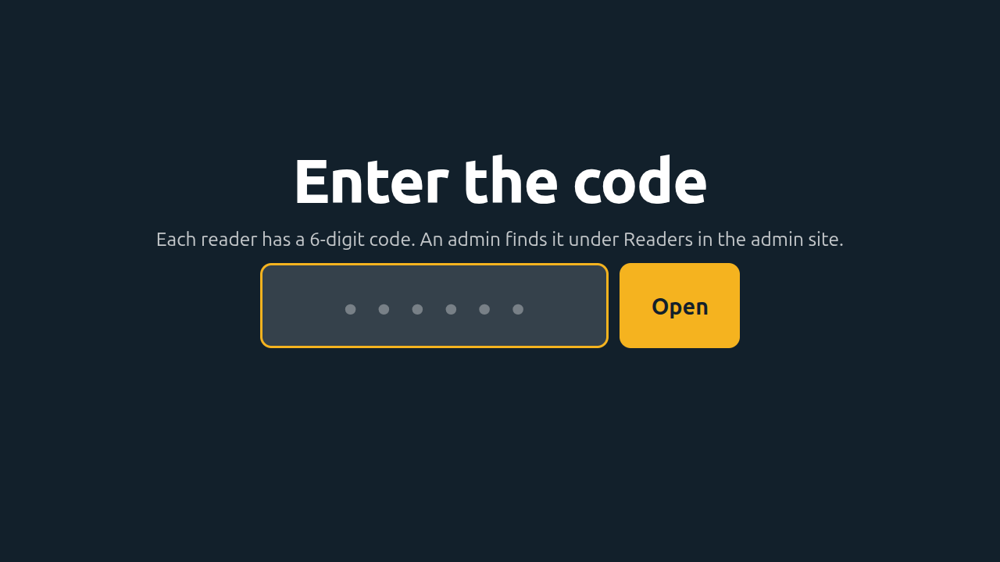
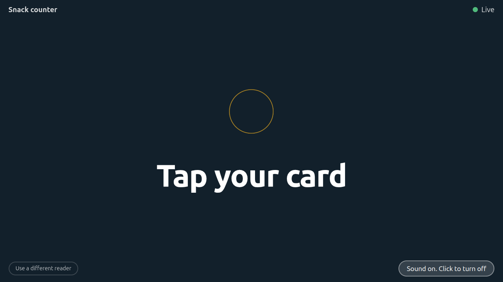
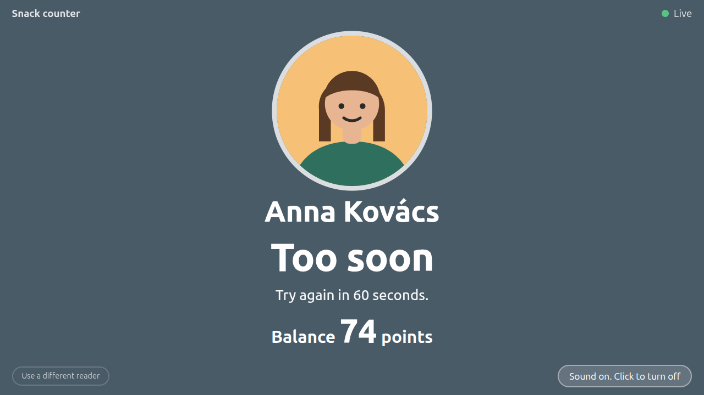

# Pont ATM

A points system for events, clubs and workspaces. People carry an NFC card (MIFARE Classic 1K works, since only its UID is read), and points go onto the card's balance on the server. There are three ways to give points, and they can run side by side:

- **Phone as a point ATM.** An operator types an amount (or taps a preset), taps a card on an Android phone, and the points are credited. The phone shows a progress bar, beeps, and shows the cardholder's photo so the operator can check the face. Operators can storno (refund) a charge without the card.
- **ESP32 readers.** A small box (ESP32 + MFRC522 + 4-digit display) that gives a **fixed number of points per tap** or works as a **sign-in / sign-out point**. See [ESP32 readers](#esp32-readers).
- **Check-in zones.** Points for time spent inside: sign in at a door, sign out when leaving, and the server pays by the zone's rules.

An **admin website** manages cards (with photos), terminals, readers, zones, staff and every transaction. A **display page** can show each tap live on a screen next to a reader.



*The terminal app. These images come from the clickable design prototype in `sketch/` (made with made-up people), not from a phone, and the app has no sign-in screen: a phone is paired with a code.*



*The admin site with dummy data. More screenshots: [Transactions](docs/images/admin-transactions.png), [Terminals](docs/images/admin-terminals.png), [Check-in zones](docs/images/admin-checkin.png), [Readers](docs/images/admin-readers.png).*

```
sketch/     Clickable HTML prototype (the approved design reference)
server/     Node + SQLite server and the admin website (served at /admin/)
android/    The terminal app (Kotlin, Jetpack Compose)
firmware/   ESP32 reader firmware (PlatformIO) with wiring and photos
docs/       Design spec, implementation plan, device test checklist, images
run-server.sh   Starts the server in the foreground using ~/.config/pont-atm/env
```

## Run the server

Needs Node 22.

```bash
cd server
npm install
JWT_SECRET=change-me ADMIN_EMAIL=admin@pont.example ADMIN_PASSWORD='choose-a-password' npm run dev
```

- `./run-server.sh` (in the repo root) does the same for a built server: it reads `~/.config/pont-atm/env`, builds when the source is newer than `dist/`, and runs the server in the foreground. It refuses to start while the `pont-atm` systemd service is running (both would want the same port).
- The admin site is at `http://localhost:3000/admin/`. The admin account is created on first start from `ADMIN_EMAIL` and `ADMIN_PASSWORD`.
- `PORT` (default 3000), `DB_PATH` (default `./data/pont.db`; photos are stored next to it) and `JWT_SECRET` (required; use a long random value) are the settings. Set `TRUST_PROXY=1` when the server sits behind a reverse proxy, so attempt limits count each client separately.
- Tests: `npm test`.
- Put it behind HTTPS before real use. The release app refuses plain HTTP.

## Run it as a service on Tailscale

This is how it runs on the dev machine. The server listens only on the machine's Tailscale address, so only devices on your tailnet can reach it (Tailscale encrypts the traffic).

```bash
cd server && npm install && npm run build          # build once; `npm start` runs dist/index.js
mkdir -p ~/.config/pont-atm ~/.local/share/pont-atm
# ~/.config/pont-atm/env (chmod 600): JWT_SECRET, ADMIN_EMAIL, ADMIN_PASSWORD, PORT=3000,
#   HOST=<this machine's Tailscale IP, from `tailscale ip -4`>, DB_PATH=$HOME/.local/share/pont-atm/pont.db
```

A systemd user unit (`~/.config/systemd/user/pont-atm.service`) runs `node dist/index.js` from `server/` with that env file; `systemctl --user enable --now pont-atm` starts it, and `loginctl enable-linger $USER` keeps it running after logout and across reboots. Logs: `journalctl --user -u pont-atm`. After pulling new code, run `npm run build` and `systemctl --user restart pont-atm`.

Address for the app and admin site: `http://<machine>.<tailnet>.ts.net:3000` (the debug APK allows plain HTTP). For HTTPS, which the release app requires, enable Tailscale Serve for the tailnet, set `HOST=127.0.0.1` and `TRUST_PROXY=1`, then run `tailscale serve --bg --https=443 http://127.0.0.1:3000`. Do not set `TRUST_PROXY=1` without a proxy in front: clients could then fake their address and dodge the login limit.

## Set up a terminal

1. In the admin site: **Terminals**, **Pair a phone**: name it (like "Bar 2") and note the 6-digit code (valid 10 minutes).
2. **Cards**, **Add card**: holder name, photo, card UID, starting points. To register a card without typing its UID: tap it on a terminal, and on the "Card not registered" screen press **Suggest for addition**. It then shows up on the admin site's Cards page under **Suggested cards**, with **Copy UID** and **Add as card** (the form opens with the UID already filled in).
3. On the phone: enter the pairing code. That is all: there is no sign-in, and the phone goes straight to the keypad. Charges are recorded under the terminal's name. To retire or lose a phone, revoke its terminal in the admin site, or use **Unpair** in the phone's terminal menu. The server address is fixed in the app at build time (`DEFAULT_BASE_URL` in `android/app/build.gradle.kts`); change it there and rebuild to point at another server.

## Build the app

Needs JDK 17 or newer (the Android Gradle Plugin does not run on Java 11) and the Android SDK.

```bash
cd android
export JAVA_HOME=/usr/lib/jvm/java-21-openjdk-amd64   # any JDK 17+
export ANDROID_HOME=$HOME/Android/Sdk
./gradlew :app:assembleDebug        # app/build/outputs/apk/debug/app-debug.apk
./gradlew :app:testDebugUnitTest    # JVM unit tests
```

Both builds use the fixed server address above. Plain HTTP is allowed only to `*.ts.net` (Tailscale encrypts it) in release, and to anything in debug. The debug build also shows two small "debug tap" links on the waiting-for-card screen so you can test without a card.

## How cards are identified

The app reads the card's UID (4, 7 or 10 bytes) and sends it to the server, which owns every balance. Nothing is stored on the card, so nobody can edit a card to gain points. A UID can be cloned with cheap hardware, which is acceptable for low-value points. If that matters, the next step is a secret block on the card checked by the server.

**Phone caveat:** only phones with an NXP NFC chip can read MIFARE Classic *sectors*. Reading the UID works on every NFC phone, which is all v1 needs. Test the terminal phones with your real cards before buying a batch (see `docs/device-test-checklist.md`).

## Check-in mode (points for time inside)



A terminal can be a sign-in / sign-out point instead of an ATM. In the admin site:

1. **Check-in** page: make **zones** (like "Workshop", "Gym"). Each zone has its own rules: points per block (say 8 per 12 minutes), how a partial block is rounded (down, up, nearest, or exact per minute), minimum stay, max points per visit, max points per 24 hours (per card, per zone), the longest stay that counts, and a re-tap lock-out. A live table shows what a stay of 5, 12, 30, 60… minutes earns.
2. **Terminals** page: set the terminal's mode to **Check-in**, pick its **zone**, and its **point type**: *Toggle* (in if outside, out if inside), *Sign in only* or *Sign out only*. The phone follows within about 30 seconds.

The phone then has no buttons: "Tap your card" (or "Tap to sign in" / "Tap to sign out"), the zone name, and after a tap the photo, name, time and points, then back to waiting after 5 seconds. A tap on the next card replaces the screen at once. Unpair and the beep switch are behind a **long press on the terminal name** at the bottom.

Good to know: a visit is paid by the rules of the zone where it began, whichever point signs out. A visit longer than the zone's longest stay earns nothing (forgotten sign-outs can't farm points). A sign-in point does not move someone who is still inside; a sign-out point does nothing for someone who isn't inside. Admins see who is inside, with Sign out and Discard buttons, and can storno a check-out award in Transactions. Admin grants and deductions (Cards, then a card, then Grant or take away) are listed in Transactions with who did it and why.

## ESP32 readers


A reader is a self-contained box built from three cheap parts: an **ESP32 DevKit V1**, an **MFRC522** card reader (13.56 MHz) and a **TM1637 4-digit 7-segment display**, wired as in [`firmware/esp32-reader/README.md`](firmware/esp32-reader/README.md) (which has the full wiring table, flashing steps and troubleshooting). The photo shows the display in the middle of its loading bar: one line per digit, one step per stage of a tap.


**How a reader joins**

1. Flash the firmware with your WiFi name, password and the server address (kept in `include/config.h`, which git ignores).
2. The reader registers with the server by itself and shows a **4-digit pairing code** on its display. If it cannot reach the server it shows `nEt`, never the code.
3. In the admin site, **Readers** lists the waiting reader with the same code and its IP address. You match the code on the display, name the reader, choose its mode, and press **Approve**. A code that doesn't match is a different device: don't approve it.
4. Within a few seconds the display shows `----` and the reader works. It keeps its identity across restarts and power cuts.

**Two modes** (switchable any time in admin, no reflashing):

- **Fixed amount**: every tap gives X points. Limits are per card: points per tap, seconds between taps, max taps and max points per rolling 24 hours, max taps ever. When a limit stops someone, the display shows the reason (`PAUS` or `FULL`) and then their balance. Grants appear in Transactions and can be stornoed like any other.
- **Check-in**: the reader is a sign-in, sign-out or toggle point for a **zone** and pays by that zone's rules (see below). Signing in shows only `In`; signing out shows `OUt` and then the points balance.

**What you see on the display.** `----` when ready; while a tap is processed, a loading bar of four lines (a line in the middle of digit 1, then 2, 3, 4), then the balance. Words: `In`, `OUt`, `PAUS` (too soon), `FULL` (limit reached), `nOIn` (not signed in), `bLoc` (card blocked), a blinking `----` (card not registered), `nEt` (no network), `OFF` (revoked). The display never blocks: tap the next card while a result is still showing and it replaces the display at once. The full list is in the firmware README.

**Details worth knowing**

- **Fast.** The reader sends the tap straight away over HTTP on your LAN. The bar steps are tied to real stages (card read, request sent, answer arriving, answer understood), so the bar is only as slow as the server.
- **Safe to retry.** Every tap carries a one-time key. If the answer is lost and the card is tapped again, the server returns the first result instead of giving the points twice.
- **Identity.** The reader makes a random secret on first start and keeps it in its flash memory. The server stores only a hash of it, so a device that copies the reader's id cannot take its place. After approval the server hands the reader a terminal token (once), which it keeps and uses like a phone does. Revoking the reader in admin cuts it off at once.
- **Limits of the hardware.** 2.4 GHz WiFi only. Plain HTTP, so use it on a network you trust (a LAN or Tailscale). It reads only the card's UID, never the card's secret sectors. A UID can be cloned with cheap hardware, which is fine for low-value points.
- **No hardware yet?** `node firmware/esp32-reader/tools/fake-reader.mjs http://<server>:3000` pretends to be a reader in the terminal. The display logic is also tested on a computer (`firmware/esp32-reader/test/host/run.sh`, 255 checks).



## Display pages (a screen next to a reader)

Every terminal has a **display page**: a screen next to the reader that shows each tap live, with the photo, name, a headline ("+10 points", "Checked in", "Too soon", "Card is blocked"), details and the balance. It returns to "Tap your card" after 6 seconds, and a new tap replaces it at once.



| Enter the code | Waiting | A refusal |
|---|---|---|
|  |  |  |

**To use it:** on the screen, open `/display` on the server (like `http://192.168.x.x:3000/display`; on another device use this computer's network address, not `localhost`) and type the reader's **6-digit code**. The code is on the admin **Readers** tab under each reader (and next to each phone on the Terminals tab). The screen then stays signed in, even after a restart, until you press **New code** or revoke the reader. The code never appears in the address. The page's "Use a different reader" button signs a screen out.

- In admin, **Copy code** copies it, **New code** replaces it and signs out every screen that used the old one at once, and **Beep on the display** switches the beep on or off. Browsers only allow sound after a click: the page shows "Click here once to allow sound", and its button then toggles sound on that screen.
- Wrong codes are limited (10 per address per 15 minutes, 300 per hour overall), because 6 digits can be guessed.
- Anyone who knows a code can watch who taps (photo, name, points), so don't post it publicly. A screen can only show photos of cards that tapped on its reader in the last hour.
- `?hold=15` on the address keeps each result on screen for 15 seconds (1 to 60) instead of 6.

## Behavior worth knowing

- A charge carries a one-time key. If the connection drops and the operator taps again, the server returns the original result instead of crediting twice.
- Storno reverses one charge in full and is refused if the card has already spent those points.
- Blocked cards and unregistered tags are refused with a clear message and change nothing.
- No offline mode. If the connection drops during a charge, the phone says it couldn't confirm: the card may already have been credited, so the operator taps again (the server answers once) or checks History before charging again.
- A paired phone stays paired until it is revoked in admin or unpaired on the phone. Anyone holding an unlocked paired phone can charge points, so revoke a lost phone straight away. Admin sessions last 12 hours and end at once when a password is reset or an account is switched off. Admin login and pairing lock out for 15 minutes after 10 wrong attempts.
