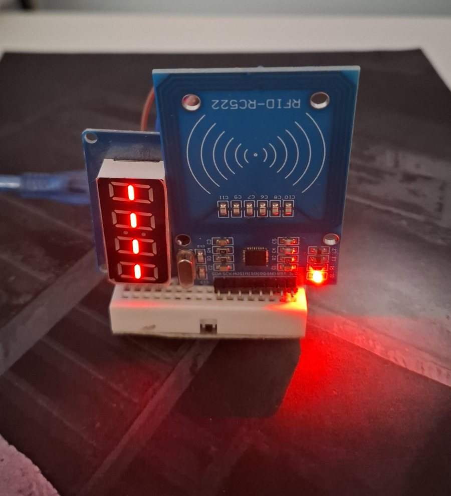
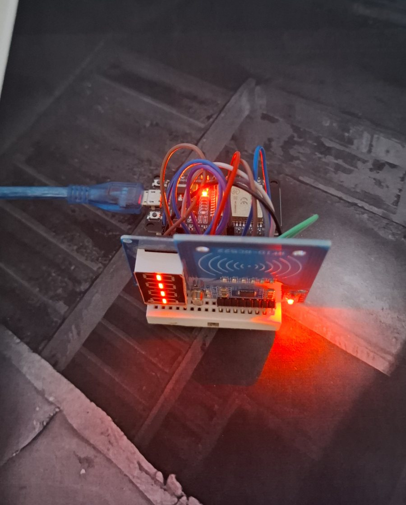

# Pont reader: ESP32 + MFRC522 + 4-digit display



A small card reader that talks to the Pont server over your WiFi (plain HTTP on your local network). In admin it appears on the **Readers** tab, and you set it up as either:

- **Fixed amount**: every tap gives the same number of points (with limits per card: seconds between taps, taps and points per 24 hours, taps ever).
- **Check-in point**: signs people in and out in a zone, as a toggle, sign-in-only or sign-out-only point.

## Parts

ESP32 DevKit V1 · MFRC522 RFID module (13.56 MHz) · TM1637 4-digit 7-segment display (pins CLK, DIO, VCC, GND) · jumper wires · USB cable.

## Wiring



**MFRC522 is 3.3 V only. Never connect it to 5 V.**

| MFRC522 | ESP32 pin |
|---|---|
| SDA (SS) | GPIO 5 |
| SCK | GPIO 18 |
| MOSI | GPIO 23 |
| MISO | GPIO 19 |
| RST | GPIO 22 |
| IRQ | not connected |
| GND | GND |
| 3.3V | 3V3 |

| TM1637 display | ESP32 pin |
|---|---|
| CLK | GPIO 16 |
| DIO | GPIO 17 |
| VCC | **3V3** (not VIN or 5V: at 5 V the display wants a stronger "high" than the ESP32's 3.3 V pins give) |
| GND | GND |

```
                 ESP32 DevKit V1                       MFRC522
              ┌──────────────────┐             ┌──────────────────┐
              │ 3V3 ─────────────┼──────┬──────┤ 3.3V             │
              │ GND ─────────────┼──┬───┼──────┤ GND              │
              │ GPIO5  ──────────┼──┼───┼──────┤ SDA (SS)         │
              │ GPIO18 ──────────┼──┼───┼──────┤ SCK              │
              │ GPIO23 ──────────┼──┼───┼──────┤ MOSI             │
              │ GPIO19 ──────────┼──┼───┼──────┤ MISO             │
              │ GPIO22 ──────────┼──┼───┼──────┤ RST              │
              │                  │  │   │      │ IRQ  (leave open)│
              │                  │  │   │      └──────────────────┘
              │                  │  │   │             TM1637 display
              │ GPIO16 ──────────┼──┼───┼──────┬──────┤ CLK
              │ GPIO17 ──────────┼──┼───┼──────┼──────┤ DIO
              │ 3V3 (same pin) ──┼──┼───┴──────┼──────┤ VCC
              │ GND (same pin) ──┼──┴──────────┴──────┤ GND
              └──────────────────┘
```

Tips: keep the RFID wires short (under 15 cm). If cards read unreliably, put a 10 µF capacitor across the module's 3.3 V and GND: WiFi bursts can dip the supply. Avoid GPIO 6 to 11 (flash) and 34 to 39 (input only) if you change pins.

## Flash it

1. Install [PlatformIO](https://platformio.org/install/cli) (`pip install platformio`).
2. `cp include/config.example.h include/config.h` and fill in your 2.4 GHz WiFi name and password and the server address (like `http://192.168.x.x:3000`). `config.h` is not committed.
3. Connect the ESP32 over USB and run `pio run -t upload`. Watch what it says with `pio device monitor`.

Give the server a fixed address in your router (a DHCP reservation) so the reader keeps finding it.

## First start: pairing

1. While it joins WiFi the display says `nEt`; then it shows a **4-digit code** (like `5254`). If it can't reach the server it shows `nEt`, never the code.
2. In admin, open **Readers**. The waiting reader is listed with the same code and its address. Give it a name, choose Fixed amount or Check-in, and press **Approve**.
3. Within a few seconds the display shows `----`: it is ready. Tap a card.

If the code on the display and the one in admin don't match, don't approve it: it is a different device.

## What the display shows

| Display | Meaning |
|---|---|
| `----` | Ready. Tap a card. |
| a line in the middle of digit 1, then 2, 3, 4 | Working on your tap. One line per stage: card read, request sent, answer arriving, answer understood. It is as fast as the server, with no waiting added |
| your balance | The result of a fixed-amount tap (numbers above 9999 scroll across), for about 3 seconds |
| `In` | Signed in. Just the word, for 2 seconds: no balance |
| `OUt` | Signed out: the word for 2 seconds, then your balance for 3 |
| `PAUS` | Too soon since your last tap (then your balance) |
| `FULL` | Limit reached: taps or points per day, or total (then your balance) |
| `nOIn` | Not signed in (at a sign-out point) |
| `bLoc` | Card is blocked |
| `----` blinking | Card is not registered. An admin sees it under Suggested cards |
| `nEt` | Can't reach the server |
| four digits steady | Waiting for approval: this is the pairing code |
| `OFF` | Revoked by an admin |
| `dEny` | The server doesn't accept this reader's secret (it was reset, or something imitates it). In admin: Revoke, Forget, and let it register again |
| `bUSy` | The server has 20 readers waiting already. Approve or reject some in admin |
| `Err` | Something else is wrong (`Err` at start: the card reader isn't answering, check the wiring) |

Nothing on the display ever blocks the reader: tap the next card while a word or a balance is still showing and it replaces the display at once.

## How it works

- **Start:** the reader joins your WiFi (up to 20 s, `nEt` if it can't), reads its stored secret (making a random one on first start), and calls `POST /device/hello` on the server: every 4 s while waiting for approval, every 30 s afterwards. The reply says `pending` (with the 4-digit code), `approved` (with the terminal token, delivered once and then stored in flash), `revoked`, or refuses the secret.
- **A tap:** the MFRC522 is polled all the time. A new card's UID is read and the card is halted, so it must leave and come back to be read again. The reader then calls `POST /fixed/tap` or `POST /presence/tap` with the UID and a one-time key (a retry after a lost answer re-uses the key, so the server never grants twice). The answer carries the result and the balance, and the display shows it.
- **The display** is a small non-blocking schedule (`include/DisplayLogic.h`, plain C++ with no hardware calls, tested on a computer). The main loop never waits for it, so the next card is read while a word or a balance is still showing.
- **What is stored in flash:** the reader's secret, its terminal token and its mode. Nothing about cards or balances: the server owns those.
- **Updates:** reflash over USB (`pio run -t upload`). The secret and token survive a reflash, unless you erase the flash.

## Trying it without the hardware

`node tools/fake-reader.mjs http://192.168.x.x:3000` pretends to be a reader: it shows its pairing code in the terminal, and you can type card UIDs to "tap" them.

## Tests

`./test/host/run.sh` tests what the display shows (digits and letters, the four-step bar, scrolling, the word for each answer, what the idle display says) on your computer. `pio run` checks that the firmware compiles.

## If something goes wrong

- **Display stays on `Err` from the start of the reader:** the MFRC522 isn't answering. Check the 3.3 V, GND and the five signal wires.
- **`dEny` after joining WiFi:** the server doesn't accept this reader's secret (for example you erased the ESP32's memory). In admin, remove the old entry (Revoke, then Forget) and the reader registers again.
- **`nEt`:** wrong WiFi details, 5 GHz network, or the server address in `config.h` is wrong or the server is off. The serial log (`pio device monitor`) says why: `reason 201` means no network with that exact name was found (check for a space at the end of the name, as in `"MyWifi "`), `reason 15` or `202` means a wrong password. When joining fails it also lists the networks it can see.
